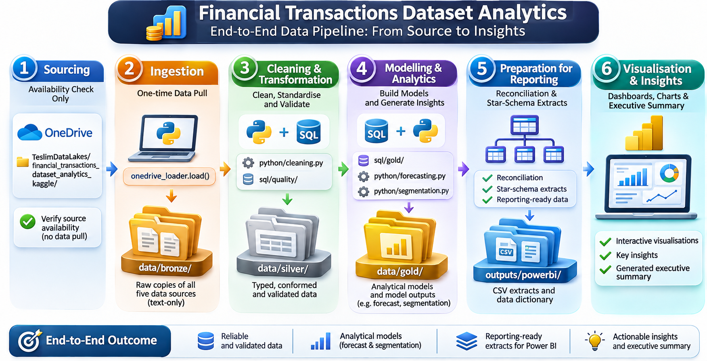

# Financial Forecasting & Variance Analysis: Project Documentation

**Research-led financial analytics | Card transaction portfolio | 2010s transaction history**

This document covers the business question, the financial concepts behind it, the data architecture, the six-stage processing lifecycle, the analytical methods, the validation controls and the work still outstanding. It is written for readers who want to know **what the project does, why each design choice was made, how to reproduce it and which conclusions are still provisional**.

**Project status (11 November 2026):** All six stages have been run end to end on the complete dataset: 13,305,915 transactions, reconciled to the published row counts. All 16 integrity controls pass, and every gold model reconciles to the silver transactions to the cent ($571,835,522.28 net spend). A Power BI report on the published extracts has not been built yet.

## Contents

### Part I: Background and Research Context

- [Research Question and Executive Summary](#research-question-and-executive-summary)
- [Card Portfolios, Forecasting and Variance Analysis](#card-portfolios-forecasting-and-variance-analysis)
- [Objectives, Scope and Definitions](#objectives-scope-and-definitions)

### Part II: Research Methodology

**Methodology: Six-Stage Data Analytics Lifecycle**

1. [Data Sourcing](#stage-1-data-sourcing): define the question, document the source and confirm availability.
2. [Data Ingestion](#stage-2-data-ingestion): pull the source once from OneDrive into the bronze layer.
3. [Data Cleaning & Transformation](#stage-3-data-cleaning--transformation): type, standardise and validate the data in silver.
4. [Data Modelling & Analytics](#stage-4-data-modelling--analytics): build the gold models, forecasts, variance tests and segments.
5. [Data Preparation for Reporting](#stage-5-data-preparation-for-reporting): reconcile and publish Power BI extracts.
6. [Data Visualisation & Insights](#stage-6-data-visualisation--insights): present the evidence and state the findings.

### Part III: Findings, Validation and Project Outcomes

- [Findings](#findings)
- [Corrections to the Earlier Analysis](#corrections-to-the-earlier-analysis)
- [Data Quality, Auditability and Limitations](#data-quality-auditability-and-limitations)
- [Reproducibility and Operational Workflow](#reproducibility-and-operational-workflow)
- [Project Deliverables and Next Steps](#project-deliverables-and-next-steps)
- [Glossary and Reference Material](#glossary-and-reference-material)

---

# PART I: BACKGROUND AND RESEARCH CONTEXT

## Research Question and Executive Summary

### Why I undertook this project

Finance teams in card issuing and payments are asked the same three questions every month: *what will next month look like, where did we deviate from plan, and which customers matter most?* In many organisations the answers come from spreadsheets that are rebuilt by hand each period, with forecasts that are never tested against what actually happened.

I developed this project to show how those questions can be answered with a **repeatable, auditable pipeline**. It combines the discipline of management accounting (budgets, variances, materiality, reconciliation) with data engineering (layered storage, SQL models, data-quality controls) and statistical modelling (backtested forecasts, significance testing, segmentation).

### Research question

> **How predictable is a card portfolio's monthly spending, which customers deviate from their expected spending, and where are value and fraud concentrated?**

The question has three parts:

| # | Sub-question | Why it matters |
| --- | --- | --- |
| 1 | Can next month's portfolio **net spend** be forecast more accurately than simple benchmarks? | A forecast is only worth building if it beats "same as last year", the benchmark every finance team already has |
| 2 | Which customers and months **deviate materially** from expected spending, and is the deviation systematic? | Random variances call for monitoring. Systematic ones mean the budgeting method itself is biased |
| 3 | How **concentrated** is customer value, and where is labelled **fraud** concentrated? | Concentration determines how much a portfolio's results depend on a small number of customers. Fraud concentration shows where controls should focus |

### Executive summary

The portfolio's monthly net spend is **highly predictable but not because of sophisticated modelling**. A SARIMA model forecast it to within 0.70% (MAPE) over a 24-month backtest, but simply repeating the same month from last year did almost exactly as well. **Budget variances net to almost nothing at portfolio level (+0.1%) but are large and frequent at customer level**: 65% of customer-months miss a trailing three-month budget by 10% or more. **Value is moderately concentrated**: the top 10% of customers generate 24% of spend. **Fraud is heavily concentrated online**, at 0.84% of labelled online transactions against 0.06% in person.

The stage 6 notebook generates this summary from the gold tables, so it updates whenever the pipeline is re-run. Details are in [Findings](#findings).

---

## Card Portfolios, Forecasting and Variance Analysis

### What the data represents

The dataset records **cardholder transactions**: each row is a purchase or a refund on a specific card, at a specific merchant, at a specific time. Each transaction is linked to the customer who holds the card, to the card's attributes (brand, debit or credit, credit limit, chip), and to a merchant category code (MCC) that classifies the type of business.

**What it doesn't contain matters as much.** There is no interchange income, no fees, no interest and no approved budget. That decides how the project frames its measures:

- The project forecasts **net spend** (purchases minus refunds), a **volume** measure. It isn't revenue, though for a card issuer, revenue from interchange broadly scales with volume.
- The "budget" in the variance analysis is a **statistical expectation** built from each customer's own history, not a plan approved by management.

### Forecasting in a finance context

A forecast that has only been tested on data it was trained on proves nothing. This project follows three principles that a finance function would expect:

1. **Benchmarks first.** Every model is compared with a *naive* forecast (next month = this month) and a *seasonal naive* forecast (next month = the same month last year). A model that doesn't beat the seasonal naive benchmark adds complexity without adding value.
2. **Walk-forward validation.** Each test month is predicted using only the months before it, and the model is retrained as each month "closes", which mirrors a monthly forecasting cycle. Random train/test splits would let the model learn from the future.
3. **No look-ahead features.** Every input to the model (lags, rolling averages, rolling volatility) is calculated from months that end before the month being predicted.

### Variance analysis

Variance analysis compares **actual** results with a **budget** and explains the difference.

| Term | Definition used in this project |
| --- | --- |
| Budget | The customer's average monthly net spend over the **previous three months** (all three must exist) |
| Variance | Actual − budget |
| Favourable | Actual ≥ budget: more volume than expected, which is good for the portfolio |
| Adverse | Actual < budget |
| Material | \|variance\| ≥ 10% of \|budget\| |

The project also asks whether variances are **systematic**. If the average customer variance is significantly different from zero, the trailing-average budget is biased. For example, it may lag behind a seasonal peak, and a better budgeting method would be needed. Variances from the same customer are correlated, so the test runs at customer level, with a non-parametric test alongside the t-test because spending is heavily skewed.

### Customer value and fraud

**RFM analysis** scores each customer on **R**ecency (days since the last transaction), **F**requency and **M**onetary value. Here frequency and value are measured **per month of tenure**, so newer customers aren't marked down simply for having had less time to transact. **Pareto analysis** measures how much of the portfolio's net spend depends on its largest customers.

**Fraud profiling** compares fraud rates across transaction attributes such as channel, entry method, card type and hour of day. Only part of the transactions carry a fraud label, so every fraud rate is calculated as *fraud ÷ labelled transactions*.

---

## Objectives, Scope and Definitions

**Objectives**

1. Build a layered, reproducible pipeline from the source files to reporting extracts, with every stage auditable.
2. Produce a monthly net-spend forecast that is benchmarked and backtested, with prediction intervals.
3. Measure customer-level variance against a non-circular budget and test whether it is systematic.
4. Segment customers by value and behaviour, and quantify value concentration and fraud concentration.
5. Publish reconciled, documented extracts for a Power BI report.

### Scope

| In scope | Out of scope |
| --- | --- |
| Portfolio-level monthly forecasting | Customer-level or merchant-level forecasting |
| Customer × month variance against a statistical budget | Comparison with an approved management budget (none exists in the data) |
| Fraud-rate profiling on labelled transactions | Building a fraud *classifier* |
| CSV extracts and a data dictionary for Power BI | A published Power BI dashboard (not yet built) |

### Key definitions

| Measure | Definition |
| --- | --- |
| Gross spend | Sum of positive transaction amounts |
| Refunds | Sum of negative transaction amounts, shown as a positive figure |
| Net spend | Gross spend − refunds (= sum of all amounts) |
| Complete month | A calendar month with transactions on every day. Edge months are excluded from forecasting and variance analysis |
| Fraud rate | Fraudulent ÷ labelled transactions |
| Activity status | Active (≤ 90 days since last transaction), At risk (91–180), Lapsed (> 180) |

---

# PART II: RESEARCH METHODOLOGY

## Methodology: Six-Stage Data Analytics Lifecycle

### Methodology roadmap



The same flow, with the module that implements each step:

```text
OneDrive  TeslimDataLakes/financial_transactions_dataset_analytics_kaggle/
   │  ① Sourcing: availability check only
   ▼  ② Ingestion: onedrive_loader.load(), one pull
data/bronze/   text-only copy of all five sources
   ▼  ③ Cleaning & transformation: python/cleaning.py, sql/quality/
data/silver/   typed, conformed, validated
   ▼  ④ Modelling & analytics: sql/gold/, python/forecasting.py, python/segmentation.py
data/gold/     analytical models and model outputs
   ▼  ⑤ Preparation for reporting: reconciliation, star-schema extracts
outputs/powerbi/   CSV extracts and data dictionary
   ▼  ⑥ Visualisation & insights: charts, generated executive summary
```

Storage is a set of Parquet files in a **bronze → silver → gold** structure, queried with **DuckDB**. Each file is exposed as a SQL view (`silver_transactions`, `gold_monthly_spend` and so on), so the analytical logic reads like ordinary warehouse SQL. DuckDB scans the files directly, which means the 13-million-row transaction table never has to be loaded into pandas for the SQL steps. That matters on an 8 GB laptop.

---

## Stage 1: Data Sourcing

**Purpose.** Define the question and confirm that the evidence needed to answer it exists.

I set out the research question and the three sub-questions, documented the five source files with their grain, keys and relationships, and recorded the source's limitations before any analysis began. The data is held in my OneDrive data lake and accessed through my own [OneDrive-Connector](https://github.com/UthmanAdeyanju/OneDrive-Connector) package (Microsoft Graph API, read-only). This gives one controlled source of truth instead of copies downloaded to individual machines.

The stage lists the OneDrive folder and stops with a clear error if any required file is missing. Nothing is downloaded at this point.

**Output:** A documented, available source.

**Technical notebook:** [Stage 1: Data Sourcing](notebook/01-data-sourcing/01-data-sourcing.ipynb)

---

## Stage 2: Data Ingestion

**Purpose.** Bring the source into a controlled environment without changing it.

Each source file is pulled from OneDrive **once** and written to the bronze layer with **every column stored as text**. Currency strings such as `$-77.00` and dates such as `09/2002` arrive exactly as published. If a value looks wrong later, bronze shows whether the problem is in the source or in the cleaning. The only reshaping is converting the two JSON dictionaries (MCC codes and fraud labels) into two-column tables.

Row counts are reconciled against the figures published with the source. The roughly 1.2 GB transactions file is parsed with the pyarrow engine to limit peak memory, and each table is written and released before the next one loads.

**Output:** Five bronze Parquet files and a load log with row reconciliation.

**Technical notebook:** [Stage 2: Data Ingestion](notebook/02-data-ingestion/02-data-ingestion.ipynb)

---

## Stage 3: Data Cleaning & Transformation

**Purpose.** Produce typed, consistently named tables and prove their integrity.

Nine documented cleaning rules are applied ([`python/cleaning.py`](python/cleaning.py)). They include:
- one key-naming convention across all tables
- signed parsing of every currency format
- keeping refunds as negative amounts (flagged with `is_refund`)
- correct `MM/YYYY` parsing of card dates
- leaving missing merchant locations on online transactions as null, instead of filling them with `'unknown'`
- dropping card numbers and CVVs

Twenty-two SQL checks then run against the silver layer ([`sql/quality/data_quality_checks.sql`](sql/quality/data_quality_checks.sql)):

| Family | Examples | Expected result |
| --- | --- | --- |
| Primary keys (PK) | Duplicate transaction, card, user and MCC identifiers | 0 flagged rows |
| Referential integrity (RI) | Transactions whose card belongs to a different user; codes with no description; labels with no transaction | 0 flagged rows |
| Parsing (NP) | Amounts, dates, income and labels that failed to parse | 0 flagged rows |
| Profiles (PR) | Refund share, error share, online share, fraud-label coverage | Informational |

The stage also identifies incomplete edge months, which are excluded from the time-based analyses.

**Output:** Five silver tables and a saved data-quality report.

**Technical notebook:** [Stage 3: Data Cleaning & Transformation](notebook/03-data-cleaning-and-transformation/03-data-cleaning-and-transformation.ipynb)

---

## Stage 4: Data Modelling & Analytics

**Purpose.** Answer the three sub-questions with methods that can be tested.

**Gold SQL models** ([`sql/gold/`](sql/gold/)):

| Model | Grain | Role |
| --- | --- | --- |
| `monthly_spend` | month | Portfolio net spend and backward-looking forecast features |
| `customer_monthly_variance` | customer × month | Actual vs trailing three-month budget, including zero-spend months within each customer's active span |
| `customer_profile` | customer | Behaviour, demographics, cards and fraud exposure |
| `category_monthly` | MCC × month | Spend and labelled fraud by merchant category |
| `fraud_profile` | attribute value | Fraud rate by channel, entry method, card type, hour and so on |

**Forecasting** ([`python/forecasting.py`](python/forecasting.py)):
- Stationarity diagnostics (Augmented Dickey–Fuller) and seasonal decomposition.
- A 24-month walk-forward backtest of four models: naive, seasonal naive, SARIMA (1,1,1)(0,1,1)₁₂ and XGBoost. XGBoost uses lags 1, 2, 3 and 12, rolling means and volatility, and month of year.
- Accuracy measured with MAE, RMSE, MAPE and R², plus improvement over the seasonal-naive benchmark.
- SHAP values to explain what drives the XGBoost forecast.
- A 12-month forward forecast from SARIMA. SARIMA is used for this because it gives model-based 95% prediction intervals.

**Variance analysis:**
- The share of favourable and material variances.
- A customer-level one-sample t-test and Wilcoxon signed-rank test of whether the mean variance is zero.

**Customer segmentation** ([`python/segmentation.py`](python/segmentation.py)):
- RFM scores (frequency and value in quintiles, recency in fixed day bands because it is heavily tied) mapped to six named segments using transparent rules.
- K-means on log-scaled, standardised RFM values as an independent cross-check, with *k* chosen by silhouette score.
- Activity status and Pareto concentration.

**Output:** Gold tables for every model and result.

**Technical notebook:** [Stage 4: Data Modelling & Analytics](notebook/04-data-modelling-and-analytics/04-data-modelling-and-analytics.ipynb)

---

## Stage 5: Data Preparation for Reporting

**Purpose.** Publish only figures that reconcile.

Before anything is exported, the gold models are reconciled back to the silver transactions: total net spend, transaction counts and one row per customer. If any check fails, the stage stops. This guards against join fan-out, which is how the earlier version of this project double-counted customer spending.

The extracts form a small star schema for Power BI:
- dimensions: `dim_customer`, `dim_month`, `dim_category`
- facts: `fact_monthly_portfolio`, `fact_customer_month_variance`, `fact_category_month`
- reference tables: model scores, variance tests, fraud profile and data-quality results

A column-level data dictionary is published with them.

**Output:** `outputs/powerbi/*.csv` and `data_dictionary.csv`.

**Technical notebook:** [Stage 5: Data Preparation for Reporting](notebook/05-data-preparation-for-reporting/05-data-preparation-for-reporting.ipynb)

---

## Stage 6: Data Visualisation & Insights

**Purpose.** Communicate the evidence and state findings that the evidence supports.

The charts follow one consistent visual system. Categorical colours come in a fixed, colour-blind-validated order, a blue/red diverging pair shows favourable against adverse, and axes are kept recessive. The charts cover:
- the monthly series with its forecast and interval
- the backtest against actuals
- model error and SHAP drivers
- monthly portfolio variance and the customers with the largest variances
- segment shares of customers and spend
- Pareto concentration
- fraud rates by attribute and by hour

The **executive summary is generated with code from the gold tables**. Each sentence, including whether a model beats its benchmark and whether a variance is significant, is computed rather than written by hand, so the narrative can't drift from the numbers.

**Output:** Charts, the executive summary and the limitations.

**Technical notebook:** [Stage 6: Data Visualisation & Insights](notebook/06-data-visualisation-and-insights/06-data-visualisation-and-insights.ipynb)

---

# PART III: FINDINGS, VALIDATION AND PROJECT OUTCOMES

## Findings

**Basis:** 13,305,915 transactions; 1,219 transacting customers (781 of the 2,000 users never transact); January 2010 to October 2019, 118 complete months; $571.8m net spend ($639.4m gross purchases less $67.5m refunds). Figures come from the executed stage 4 and stage 6 notebooks.

### 1. Forecasting

| Model (24-month walk-forward) | MAPE | RMSE | R² |
| --- | --- | --- | --- |
| **SARIMA (1,1,1)(0,1,1)₁₂** | **0.70%** | $42,037 | 0.91 |
| Seasonal naive (same month last year) | 0.70% | $43,744 | 0.90 |
| XGBoost | 0.74% | $47,981 | 0.88 |
| Naive (last month) | 3.56% | $230,548 | −1.80 |

- **The series is stable and seasonal.** Monthly net spend sits between about $4.4m and $5.1m. Both seasonal strength and trend strength measure 0.95. Annual spend grew 2–3% a year to 2013 and has been flat since 2016.
- **The seasonality is mostly calendar.** February averages $4.45m against about $4.9m for other months. That is roughly the 28-against-30/31-day ratio, so it reflects the number of days, not a change in behaviour.
- **Model complexity adds little.** SARIMA beats the seasonal-naive benchmark by only 0.4% on MAPE, and XGBoost does slightly worse than the benchmark. SHAP confirms why: `lag_12_month` drives 48% of XGBoost's predictions. Last-month naive fails (R² −1.80) because it ignores seasonality.
- **The forward outlook** (November 2019 to October 2020) ranges from $4.5m to $5.0m a month. The 95% intervals widen from ±2.4% to ±5.1% across the 12 months (about ±4% on average).

**Implication:** for portfolio-level planning, a seasonal-naive budget is a defensible, transparent baseline. A statistical model is justified for its prediction intervals rather than for better point accuracy.

### 2. Variance analysis

- **136,289 customer-months** from 1,219 customers were tested against a trailing three-month budget.
- **48% were favourable and 52% adverse.** Net variance was **+$0.59m on $557.2m of budget (+0.1%)**.
- The customer-level mean variance is **statistically significant** (t-test p = 2.9 × 10⁻¹², Wilcoxon p = 1.4 × 10⁻¹³), but **economically negligible**. With this many observations, even a $5 average gap tests as significant.
- **At customer level the budget is noisy:** 65% of customer-months are material (≥ 10% off budget). Material adverse months total −$41.5m and material favourable months +$43.0m, so they almost cancel out.

**Implication:** a trailing average is fit for portfolio planning but not for monitoring individual customers. A customer-level budget would need seasonality and at least a twelve-month history.

### 3. Customer value

| Segment | Customers | Share of customers | Share of net spend |
| --- | --- | --- | --- |
| Champions | 529 | 43.4% | 64.5% |
| Loyal | 140 | 11.5% | 9.7% |
| Promising | 534 | 43.8% | 25.1% |
| Can't Lose / At Risk / Hibernating | 16 | 1.3% | 0.8% |

- **Concentration is moderate:** the top 10% of customers generate 24% of net spend, and 60% of customers generate 80%. That is flatter than a classic 80/20 pattern.
- **Almost everyone is active.** 91% of customers transacted on the final day of the data, and only 13 have lapsed (no transaction for more than 180 days). Recency therefore carries little information, and the segments mainly separate customers by **frequency and monthly spend**. The recency scoring was changed from quintiles to fixed bands after the first run, when quintiles were found to split tied customers arbitrarily.
- **K-means agrees with the rules.** It picks k = 3 (silhouette 0.44), and its clusters line up with the rule-based tiers: every Champion is in cluster 1 and every Promising customer in cluster 2.

### 4. Fraud (labelled transactions only, 8.9m of 13.3m)

| Attribute | Fraud rate |
| --- | --- |
| Overall | 0.15% |
| **Online** vs in person | **0.84%** vs 0.06% (about 14×) |
| Chip vs swipe (in person) | 0.10% vs 0.03% |
| Error-flagged vs no error | 0.40% vs 0.15% |
| Prepaid debit / credit / debit | 0.23% / 0.16% / 0.14% |

**Implication:** fraud controls should be weighted towards card-not-present (online) transactions and transactions carrying an error code. The higher chip-than-swipe rate goes against the usual expectation, and with the dataset's provenance unknown, it should be treated as a feature of this data rather than a general finding.

---

## Corrections to the Earlier Analysis

This repository replaces an earlier single notebook (still available in the [git history](https://github.com/TeslimAdeyanju/Financial-Forecasting-Variance-Analysis/blob/d9d7bcbc354ae1a3cd7637f1e3ecc81f0e166fb6/Financial-Data-Analytics-Forecasting-Variance-Analysis.ipynb) for transparency). An audit of that notebook found problems that **invalidated its results**, not just its layout:

| # | Issue in the earlier notebook | Consequence | Correction |
| --- | --- | --- | --- |
| 1 | Rolling averages and cumulative revenue included the month being predicted | Forecast features contained the target, so accuracy was overstated | All windows end at the previous month and stay null until full |
| 2 | "Budget" was the average of the same customer-month being measured | Variances summed to zero by construction, so the significance test was meaningless | Budget comes from the three previous months only |
| 3 | The segmentation query joined monthly rows before aggregating | Customer frequency and spend were multiplied by the number of active months | Customer measures are aggregated directly from transactions |
| 4 | Fraud labels and MCC codes were never reshaped into joinable columns | The business-intelligence query couldn't run | Reshaped in bronze, typed in silver |
| 5 | Card open dates were parsed as `MM/DD/YYYY` instead of `MM/YYYY` | Every value became missing | Correct format, with a parsing control |
| 6 | The measure was called "revenue". LSTM, DBSCAN and a Power BI dashboard were claimed | The analysis overstated its scope | Renamed net spend. Claims limited to what is implemented |
| 7 | "CLV" = average value × frequency × lifespan | This reduces to total historical spend | Reported as historical net spend and average monthly spend, with no predictive claim |
| 8 | The executive summary contained fixed text, such as "seasonality confirmed" | Conclusions didn't depend on the results | The summary is generated from computed results |

---

## Data Quality, Auditability and Limitations

### Controls that make the project credible

| Control | Where |
| --- | --- |
| Single, read-only source of truth (OneDrive via Graph API) | Stages 1–2 |
| Raw values kept as text in bronze | Stage 2 |
| Row-count reconciliation against published source counts | Stage 2 |
| 22 primary-key, referential-integrity, parsing and profiling checks | Stage 3 |
| Edge-month detection and exclusion | Stages 3–4 |
| Leak-free features and walk-forward validation against benchmarks | Stage 4 |
| Gold-to-silver reconciliation that blocks export | Stage 5 |
| Sensitive card fields removed at silver | Stage 3 |
| Findings generated from data, not hand-written | Stage 6 |

### Limitations

1. **Provenance.** The publisher doesn't document how the records were produced. The findings demonstrate a method and should not be read as statements about a real bank's portfolio.
2. **Volume, not revenue.** Net spend measures transaction value. Issuer profitability would need interchange, fee, interest and cost data.
3. **Statistical budget.** The trailing three-month budget lags trends and seasonality by design. If the variance tests show it is biased, that finding is about the budgeting method, not customer behaviour.
4. **Partial fraud labels.** If labelling wasn't random, fraud rates are biased in an unknown direction.
5. **Single-series forecast.** The forecast is at portfolio level, assumes past patterns continue, and can't anticipate shocks after the data ends.

### Meaning of validation in this project

"Validated" in this project means three things: the stage 3 controls passed, the stage 5 reconciliation passed, and the forecast was evaluated out of sample. It does **not** mean the source data has been independently verified against an external record. No such record exists for this dataset.

---

## Reproducibility and Operational Workflow

### Prerequisites

- Python 3.13 with a project virtual environment, and the packages in [`requirements.txt`](requirements.txt).
- The [OneDrive-Connector](https://github.com/UthmanAdeyanju/OneDrive-Connector), installed in editable mode, with its `.env` holding the Azure app client ID, tenant ID and client secret.
- About 8 GB of RAM. Stage 2 is the most memory-intensive step.

### Intended sequence

```bash
uv venv .venv --python 3.13
uv pip install --python .venv/bin/python -r requirements.txt
uv pip install --python .venv/bin/python -e /Users/teslim/TeslimWorkSpace/OneDrive-Connector

# Execute the six stages in order from the repository root.
for s in notebook/0*/; do
  n=$(basename "$s"); .venv/bin/jupyter nbconvert --to notebook --execute --inplace "$s$n.ipynb"
done
```

After the first run, any stage from 3 onwards can be re-run on its own, because it reads the cached output of the stage before it. Only stage 2 contacts OneDrive.

### Outputs to retain for an auditable run

- The executed notebooks, with their outputs.
- The stage 2 load log and the stage 3 data-quality report (`gold/data_quality_checks`).
- The stage 5 reconciliation table and the published extracts with their data dictionary.

---

## Project Deliverables and Next Steps

| Deliverable | Status |
| --- | --- |
| Six-stage pipeline (notebooks, Python modules, SQL) | Complete |
| Full run on the complete dataset | Complete: controls and reconciliation pass |
| Findings in the README and this document | Complete |
| Power BI report built on the stage 5 extracts | Not started |

### Recommended order of completion

1. Build the Power BI report on the star-schema extracts in `outputs/powerbi/`.
2. Optionally, extend the variance analysis with a seasonal customer-level budget (same month last year, adjusted for trend), and compare its materiality rate with the trailing average.
3. Upstream the resumable chunked download from `python/ingestion.py` into the OneDrive-Connector package.

### What the project demonstrates

- Management-accounting judgement: budgets, variances, materiality and reconciliation.
- Data engineering: a layered architecture, SQL modelling and automated data-quality controls.
- Statistical honesty: benchmarked, walk-forward forecasts, appropriate significance tests, and findings that are computed rather than asserted.

---

## Glossary and Reference Material

| Term | Meaning |
| --- | --- |
| ADF test | Augmented Dickey–Fuller test for whether a series is stationary |
| Bronze / silver / gold | Raw, cleaned and analytical storage layers |
| MAPE | Mean absolute percentage error of a forecast |
| MCC | Merchant category code: a four-digit code classifying the type of business |
| Naive / seasonal naive | Forecast = last month / the same month last year |
| RFM | Recency, frequency and monetary-value scoring of customers |
| SARIMA | Seasonal autoregressive integrated moving-average model |
| SHAP | SHapley Additive exPlanations: each feature's contribution to a model's prediction |
| Walk-forward validation | Repeatedly training on the past and predicting the next period, as in live use |

### Primary references

- [Financial Transactions Dataset: Analytics (Kaggle)](https://www.kaggle.com/datasets/computingvictor/transactions-fraud-datasets)
- [OneDrive-Connector](https://github.com/UthmanAdeyanju/OneDrive-Connector)

### Repository technical references

- [README](README.md): overview, lifecycle and reproduction
- [`sql/gold/`](sql/gold/): analytical models
- [`sql/quality/data_quality_checks.sql`](sql/quality/data_quality_checks.sql): data-quality controls
- [`python/`](python/): ingestion, cleaning, warehouse, forecasting, segmentation and chart modules
