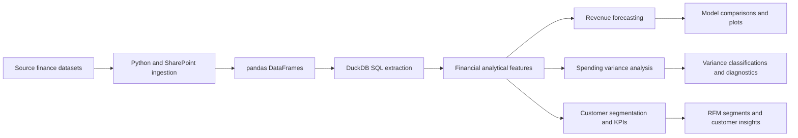

# Financial Forecasting, Variance Analysis and Customer Insights

> A financial data analytics case study combining SQL-based feature extraction, time-series forecasting, budget-versus-actual analysis, customer segmentation and financial performance reporting.

**Status:** Research notebook with implemented analysis and modelling code. Reproduction requires access to the source data and completion of a clean end-to-end validation.  
**Technologies:** Python, pandas, DuckDB SQL, statsmodels, XGBoost, scikit-learn, SHAP, Matplotlib, Seaborn, SharePoint/OneDrive.

## Executive Summary

Financial teams need reliable revenue forecasts, clear explanations of spending variances and a better understanding of customer behaviour. This project brings these tasks together in a single analytical workflow. Transaction and customer datasets are integrated, queried using SQL, converted into forecasting and reporting features, and used for statistical and machine learning analysis.

The main deliverable is the Jupyter notebook, `Financial-Data-Analytics-Forecasting-Variance-Analysis.ipynb`. It contains code for time-series analysis, comparative forecasting, variance classification, statistical testing, RFM segmentation and customer-focused financial KPIs.

**Evidence boundary:** The repository contains the analysis and model evaluation procedures, but its notebook does not currently provide saved numerical result outputs that can be independently verified from the GitHub files. This README therefore describes methods and implemented code without inventing accuracy scores or business improvements.

## Business Problem and Objectives

Finance and commercial teams often work across disconnected datasets and need to translate raw transactions into decisions. This project addresses four related questions:

1. **Forecasting:** What revenue can be expected from historical transaction patterns?
2. **Variance analysis:** Where does actual customer spending differ from historical spending benchmarks?
3. **Customer insights:** Which customer segments exhibit different recency, frequency and monetary patterns?
4. **Performance reporting:** How can customer lifetime value, churn indicators and revenue concentration inform management reporting?

The objective is an integrated analytical workflow, not a live or production-ready finance platform.

## Data Sources and Integration

The notebook references datasets loaded through a SharePoint/OneDrive integration:

| Source | Main analytical use |
| --- | --- |
| Users data | Customer attributes and joins |
| Cards data | Payment card context |
| Merchant category codes | Transaction classification |
| Transaction data | Revenue and spending history |
| Fraud labels | Supporting transaction risk context |

Actual source data files are **not committed** in this repository. Access requires the appropriate source files and credentials. A template for configuration variables is provided in `.env.example`; never commit real tokens, credentials or personal financial data.

The notebook registers loaded pandas DataFrames in an **in-memory DuckDB connection**, allowing SQL queries without requiring a separate database server.

## Analytical Architecture



## Methodology

### 1. SQL extraction and feature engineering

The notebook contains SQL queries to construct monthly revenue and lag-based forecasting features, budget-versus-actual spending comparisons, customer spending patterns and business intelligence datasets. It includes lag features and three- and six-month rolling averages for revenue modelling.

### 2. Revenue forecasting

The analysis uses time-series stationarity testing with the Augmented Dickey-Fuller test and seasonal decomposition. It includes a **walk-forward comparison of XGBoost, ARIMA(1,1,1) and a naive baseline**, preserving chronological order during evaluation.

The model comparison code calculates:

| Metric | Interpretation |
| --- | --- |
| MAE | Average absolute forecast error |
| RMSE | Error measure that places greater weight on large misses |
| MAPE | Average percentage forecast error, subject to limitations near zero |
| R² | Relative fit measure; interpret cautiously on short time series |

The notebook also includes forecast-versus-actual plots and XGBoost feature analysis. A residual-based 95% display band appears in the notebook, but should not be represented as a calibrated probabilistic prediction interval without further testing.

### 3. Variance analysis

The workflow constructs spending variance features, classifies favourable and unfavourable movements, performs a one-sample significance test against zero, identifies major customer contributors and visualises variance through a waterfall-style analysis.

**Important interpretation:** The spending benchmark is derived from historical averages in the notebook. It is not necessarily an approved financial budget. The favourable/unfavourable classification depends on the chosen spending perspective.

### 4. Customer segmentation and KPI analysis

Customer analytics includes Recency, Frequency and Monetary (RFM) scoring, quintile-based customer profiles and K-Means clustering. The notebook explores cluster counts with an elbow chart and creates four customer segment labels.

Further sections address indicative customer lifetime value, churn risk and revenue concentration. These are analytical proxies based on available data and assumptions, rather than externally validated commercial outcomes.

## Outputs and Results Status

| Output | Repository evidence | Verification status |
| --- | --- | --- |
| SQL feature extraction | Notebook queries | Code present |
| ARIMA/XGBoost/naive model comparison | Walk-forward validation and metric computation | Numerical results not independently reproduced |
| Variance diagnostics | Classification, t-test and chart code | Data-dependent results need reproduction |
| RFM and K-Means segmentation | Scoring, clustering and profile code | Data-dependent results need reproduction |
| Executive reporting summary | Summary-generation code | Values not independently verified |

The notebook is the authoritative source for the implementation. Do not quote specific forecasting accuracy or business benefit figures without rerunning and retaining the evaluation output.

## Repository Structure

```text
Financial-Data-Analytics-Forecasting-Variance-Analysis.ipynb
requirements.txt
.env.example
.gitignore
README.md
docs/
    legacy-readme.md
```

## Setup and Reproducibility

1. Clone the repository and create a Python virtual environment.
2. Install the packages listed in `requirements.txt`.
3. Copy `.env.example` to `.env` and configure a valid, authorised SharePoint/OneDrive connection.
4. Provide the required datasets and check access permissions.
5. Open the notebook and run its cells in order after confirming the data schema.

```bash
git clone https://github.com/TeslimAdeyanju/Financial-Forecasting-Variance-Analysis.git
cd Financial-Forecasting-Variance-Analysis
python3 -m venv .venv
source .venv/bin/activate
python -m pip install -r requirements.txt
cp .env.example .env
jupyter notebook Financial-Data-Analytics-Forecasting-Variance-Analysis.ipynb
```

The instructions above are a starting point, **not a verified one-command execution**. Some notebook sections read intermediate CSVs such as `spending_variance_analysis_data.csv` and `business_intelligence_data.csv` from the working directory even though earlier sections save analysis tables through SharePoint. These paths and data exchange steps require reconciliation. The SharePoint authentication path also depends on tenant and app registration configuration.

## Limitations and Next Steps

- Document the licensed or permitted data source and provide a non-sensitive sample dataset or synthetic test fixture.
- Make source and intermediate file locations configurable and reproducible.
- Separate extraction, feature engineering, forecasting and reporting into testable modules.
- Validate forecasting against a sufficiently long, appropriate temporal holdout and capture numerical evaluation outputs.
- Check for feature leakage and ensure each forecast's predictors are known at prediction time.
- Validate benchmark definitions for variance analysis and any statistical testing assumptions.
- Test cluster stability and the business meaning of customer segment labels.
- Add reproducible dashboards or screenshots generated from the analysis.
- Avoid committing credentials or private customer information.

## Skills Demonstrated

Financial analysis, SQL extraction, data transformation, time-series modelling, regression evaluation, variance investigation, customer segmentation, model interpretability and executive reporting.

## Author

**Teslim Adeyanju**  
[GitHub](https://github.com/TeslimAdeyanju) | [Portfolio](https://adeyanjuteslim.co.uk) | [LinkedIn](https://www.linkedin.com/in/adeyanjuteslimuthman)

[Original README archive](docs/legacy-readme.md)
